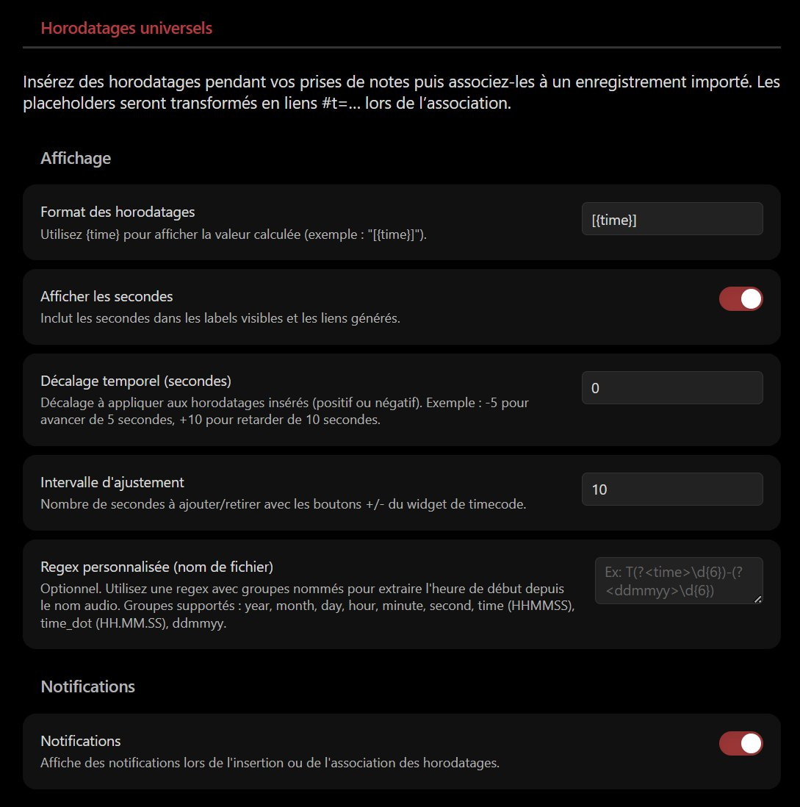
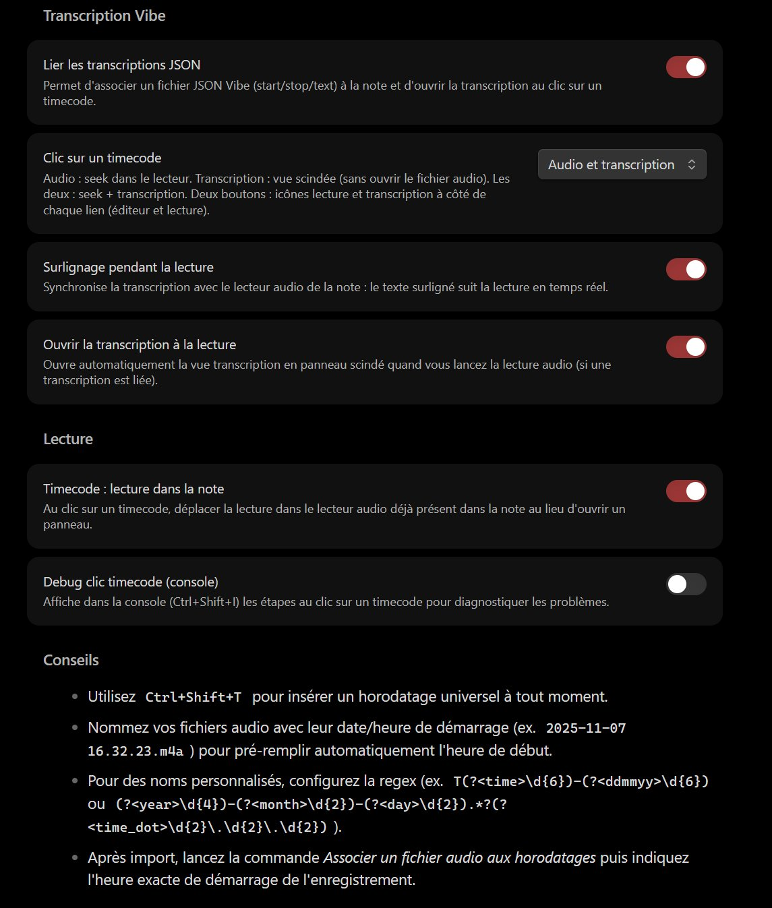

<div align="center">

<table>
<tr>
<td></td>
<td align="left">
<h1 style="margin:0">Universal Timestamp</h1>
<p style="margin:0.25em 0 0"><strong>Universelle Zeitstempel · Notizen während Aufnahme · #t=-Links</strong><br/>Obsidian-Plugin · Audio / Video · Systemuhr</p>
</td>
</tr>
</table>

<a href="https://atelier.atechnologie.fr/" title="l'Atelier – Verein für Buchherstellung und Forschungswerkzeuge"></a>  
<sub>Entwickelt von <a href="https://atelier.atechnologie.fr/">l'Atelier</a> — Buchherstellung und Forschungswerkzeuge (EHESS)</sub>

<p>
🇫🇷 <a href="README.md">Français</a> ·
🇬🇧 <a href="README.en.md">English</a> ·
🇩🇪 <a href="README.de.md"><b>Deutsch</b></a> ·
🇪🇸 <a href="README.es.md">Español</a>
</p>

<p>
<a href="https://atelier.atechnologie.fr/"></a>
<a href="https://github.com/Atelier-Recherche/Universal-Timestamp"></a>
<a href="https://obsidian.md/plugins?search=BRAT#"></a>
</p>

</div>

---

## 📸 Übersicht

| Einfügen | Umwandlung |
| :---: | :---: |
|  |  |

---

## 📖 Über das Plugin

Ein Obsidian-Plugin zum Notieren während einer aufgenommenen Session (Audio oder Video) mit **universellen Zeitstempeln** auf Basis der Systemuhr. Nach dem Import der Aufnahme werden die Stempel in klickbare `#t=`-Links umgewandelt.

> **Hinweis**: Das Plugin zeichnet kein Audio auf. Es konzentriert sich auf Notizen und Zeitsynchronisation mit einer externen Aufnahme. Unter Android eignet sich [android-audio-recorder](https://gitlab.com/axet/android-audio-recorder) gut zum Aufnehmen.

## 🌟 Funktionen

- **📝 Universelle Zeitstempel**: `Ctrl+Shift+T` fügt einen zeitgestempelten Marker (`%%REC{...}%%`) mit lesbarem Label ein.
- **🔗 Kontrollierte Umwandlung**: Befehl „Associate an audio file with timestamps“ / „Associer un fichier audio…“ wandelt Marker in Links `[[datei#t=123|[02:03]]]` um.
- **🔔 Kontextvorschlag**: Wird ein Link zu einer Audiodatei in die Notiz eingefügt, kann das Plugin sofort die Umwandlung anbieten (nie erzwungen).
- **📂 Dateierkennung**: automatische Erkennung von Audiodateien im Vault (MP3, WAV, M4A, OGG, WebM, MP4, AAC, FLAC).
- **⚙️ Schlanke Einstellungen**: Label-Format `{time}`, Sekunden an/aus, Benachrichtigungen.

## ⬇️ Installation über BRAT (1 Klick)

> **Plugin-ID (Obsidian-Katalog)**: `universal-timestamp` — der Ordner unter `.obsidian/plugins/` muss **`universal-timestamp`** heißen.

1. 🔌 **BRAT** installieren: [Obsidian — BRAT](https://obsidian.md/plugins?search=BRAT#)
2. ➕ Dieses Repository mit *„Add Beta plugin“* hinzufügen:  
   `https://github.com/Atelier-Recherche/Universal-Timestamp`

> 💡 Unsere Plugins können noch auf die Katalogprüfung warten; BRAT ermöglicht den sofortigen Test. Siehe auch 🌐 [l’Atelier](https://atelier.atechnologie.fr/).

### Manuelle Installation

1. `main.js`, `manifest.json` und `styles.css` herunterladen
2. Ordner `universal-timestamp` in `.obsidian/plugins/` anlegen
3. Dateien in diesen Ordner legen
4. Obsidian neu starten
5. Plugin in den Einstellungen aktivieren

## 🚀 Verwendung

### 1. Während des Notierens

- An jedem gewünschten Zeitmarker den Befehl **„Insérer un horodatage universel“** / **„Insert a universal timestamp“** ausführen (`Ctrl+Shift+T` standardmäßig).
- Ein Platzhalter wie `%%REC{"time":"2025-11-08T16:32:23.123Z"}%%[16:32:23]` wird an der Cursorposition eingefügt.

### 2. Nach der Aufnahme

- Audio-/Videodatei in den Obsidian-Vault kopieren oder importieren.
- Enthält der Dateiname Startzeit/Datum (`2025-11-07 16.32.23.m4a`), füllt das Plugin die Startzeit voraus.

### 3. Umwandlung der Zeitstempel

- Notiz mit Platzhaltern öffnen.
- Befehl **„Associer un fichier audio aux horodatages“** ausführen.
  - Audiodatei wählen.
  - Startzeit bei Bedarf anpassen (`YYYY-MM-DD HH:mm:ss`).
- Alle referenzierten Platzhalter werden durch klickbare `#t=`-Links ersetzt.

### Kontextuelle Vorschläge

Fügen Sie einen `[[...]]`-Link zu einer erkannten Audiodatei ein, bietet ein Dialog die sofortige Umwandlung an (Ablehnen und später möglich).

## ⚙️ Einstellungen

- **Zeitstempel-Format**: sichtbares Label anpassen (`[{time}]`, `({time})`, usw.).
- **Sekunden anzeigen**: Sekunden in Labels und Links ein-/ausschalten.
- **Benachrichtigungen**: Hinweise beim Einfügen und/oder bei der Umwandlung.

## 📋 Verfügbare Befehle

- `Insérer un horodatage universel` / `Insert a universal timestamp`
- `Associer un fichier audio aux horodatages` / `Associate an audio file with timestamps`

## 🔧 Entwicklung

### Voraussetzungen

- Node.js 16+
- npm oder yarn

```bash
npm install
npm run dev
npm run build
```

## 📱 Kompatibilität

| Plattform | Status |
|------------|--------|
| Windows Desktop | ✅ Unterstützt |
| macOS Desktop | ✅ Unterstützt |
| Linux Desktop | ✅ Unterstützt |
| Android | ✅ Unterstützt |
| iOS | ✅ Unterstützt |

## Katalogkonformität Obsidian

| Element | Detail |
| --- | --- |
| **Lizenz** | MIT — [LICENSE](LICENSE) |
| **Netzwerk** | nein — lokale Zeitstempel, Audiodateien nur im Vault |
| **Dateien außerhalb des Vaults** | nein |
| **Telemetrie / Auto-Update** | nein |
| **Release** | `.\Release-Plugin.ps1` |

## 🙏 Danksagung

Inspiriert von [Media Extended](https://github.com/aidenlx/media-extended), mit Fokus auf Aufnahme-Hinweise und mobile Kompatibilität.

## 🔗 Ressourcen

| | |
| --- | --- |
| 🌐 **l'Atelier** | [atelier.atechnologie.fr](https://atelier.atechnologie.fr/) |
| 📦 **Repository** | [github.com/Atelier-Recherche/Universal-Timestamp](https://github.com/Atelier-Recherche/Universal-Timestamp) |

---

<div align="center">

<sub><a href="README.md">🇫🇷 Français</a> · <a href="README.en.md">🇬🇧 English</a> · <b>🇩🇪 Deutsch</b> · <a href="README.es.md">🇪🇸 Español</a></sub>

</div>
