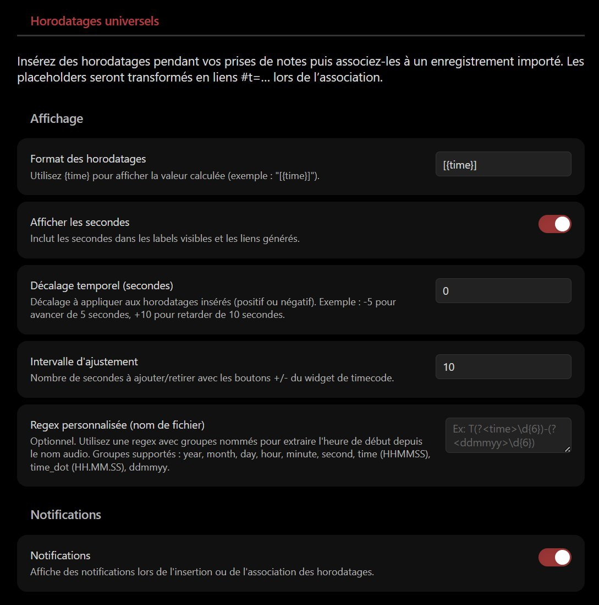
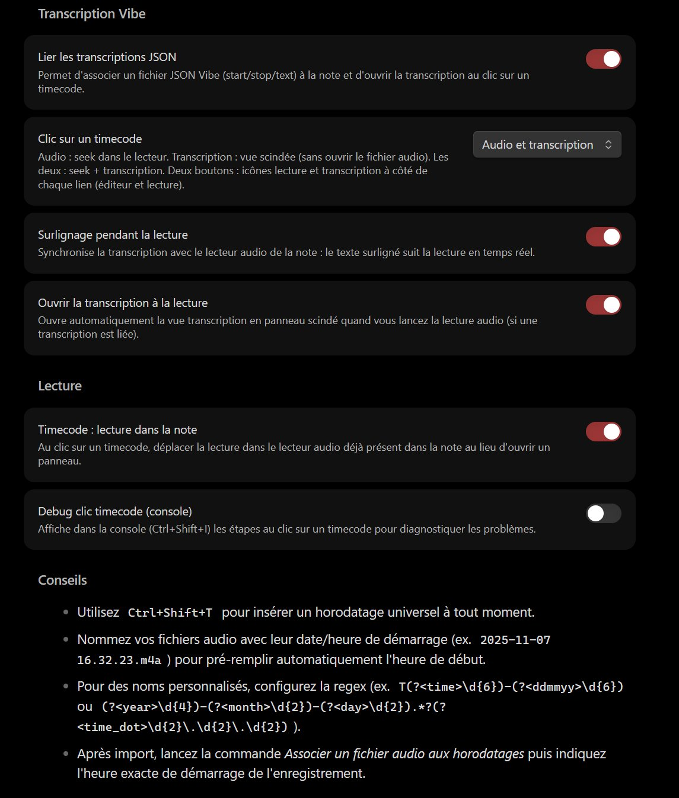

<div align="center" id="head">


<table>
<tr>
<td></td>
<td align="left">
<h1 style="margin:0">Universal Timestamp</h1>
<p style="margin:0.25em 0 0"><strong>Universal timestamps · notes during recording · #t= links</strong><br/>Obsidian plugin · audio / video · system clock</p>
</td>
</tr>
</table>

<a href="https://atelier.atechnologie.fr/" title="l'Atelier – book-making and research-tools association"></a>  
<sub>Developed by <a href="https://atelier.atechnologie.fr/">l'Atelier</a> — book-making and research tools (EHESS)</sub>

<p>
🇫🇷 <a href="README.md">Français</a> ·
🇬🇧 <a href="README.en.md"><b>English</b></a> ·
🇩🇪 <a href="README.de.md">Deutsch</a> ·
🇪🇸 <a href="README.es.md">Español</a>
</p>

<p>
<a href="https://atelier.atechnologie.fr/"></a>
<a href="https://github.com/Atelier-Recherche/Universal-Timestamp"></a>
<a href="https://obsidian.md/plugins?search=BRAT#"></a>
</p>

</div>

---

## 📸 Overview

 

---

## 📖 About

An Obsidian plugin for taking notes during a recorded session (audio or video) by generating **universal timestamps** based on the system clock. Once the recording is imported, timestamps are converted into clickable `#t=` links.

> **Note**: the plugin does not record audio. It focuses on note-taking and time sync with an external recording. On Android, [android-audio-recorder](https://gitlab.com/axet/android-audio-recorder) works well for recording.

## 🌟 Features

- **📝 Universal timestamps**: `Ctrl+Shift+T` inserts a time-stamped marker (`%%REC{...}%%`) with a readable label.
- **🔗 Controlled conversion**: command “Associate an audio file with timestamps” turns markers into `[[file#t=123|[02:03]]]` links.
- **🔔 Contextual prompt**: when an audio file link is inserted in the note, the plugin can offer to run conversion immediately (never forced).
- **📂 File recognition**: automatic detection of audio files already in the vault (MP3, WAV, M4A, OGG, WebM, MP4, AAC, FLAC).
- **⚙️ Lean settings**: label format `{time}`, show/hide seconds, notifications.

## ⬇️ Install via BRAT (one click)

> **Plugin ID (Obsidian community)**: `universal-timestamp` — the folder under `.obsidian/plugins/` must be named **`universal-timestamp`**.

1. 🔌 Install **BRAT**: [Obsidian — BRAT](https://obsidian.md/plugins?search=BRAT#)
2. ➕ Add this repo with *“Add Beta plugin”*:  
   `https://github.com/Atelier-Recherche/Universal-Timestamp`

> 💡 Our plugins may be pending Obsidian directory review; BRAT lets you try them now. See also 🌐 [l’Atelier](https://atelier.atechnologie.fr/).

### Manual install

1. Download `main.js`, `manifest.json`, and `styles.css`
2. Create a `universal-timestamp` folder in `.obsidian/plugins/`
3. Place the downloaded files in that folder
4. Restart Obsidian
5. Enable the plugin in settings

## 🚀 Usage

### 1. While taking notes

- At each desired time cue, run **“Insert a universal timestamp”** (`Ctrl+Shift+T` by default).
- A placeholder such as `%%REC{"time":"2025-11-08T16:32:23.123Z"}%%[16:32:23]` is inserted at the cursor.

### 2. After recording

- Copy or import the audio/video file into your Obsidian vault.
- If the filename includes the start date/time (`2025-11-07 16.32.23.m4a`, for example), the plugin will pre-fill the start time.

### 3. Converting timestamps

- Open the note containing your placeholders.
- Run **“Associate an audio file with timestamps”**.
  - Choose the audio file to link.
  - Adjust the start time if needed (`YYYY-MM-DD HH:mm:ss`).
- All referenced placeholders are replaced with clickable `#t=` links.

### Contextual suggestions

If you add a `[[...]]` link to a recognized audio file, a dialog offers to convert immediately (you can decline and do it later).

## ⚙️ Settings

- **Timestamp format**: customize the visible label (`[{time}]`, `({time})`, etc.).
- **Show seconds**: enable/disable seconds in labels and links.
- **Notifications**: show notices on insert and/or conversion.

## 📋 Available commands

- `Insert a universal timestamp`
- `Associate an audio file with timestamps`

## 🔧 Development

### Prerequisites

- Node.js 16+
- npm or yarn

```bash
npm install
npm run dev
npm run build
```

## 📱 Compatibility

| Platform | Status |
|------------|--------|
| Windows Desktop | ✅ Supported |
| macOS Desktop | ✅ Supported |
| Linux Desktop | ✅ Supported |
| Android | ✅ Supported |
| iOS | ✅ Supported |

## Obsidian directory compliance

| Item | Detail |
| --- | --- |
| **License** | MIT — [LICENSE](LICENSE) |
| **Network** | no — local timestamps, audio files in the vault only |
| **Files outside vault** | no |
| **Telemetry / auto-update** | no |
| **Release** | `.\Release-Plugin.ps1` |

## 🙏 Acknowledgements

Inspired by [Media Extended](https://github.com/aidenlx/media-extended), with a focus on the recording cue workflow and mobile compatibility.

## 🔗 Resources

| | |
| --- | --- |
| 🌐 **l'Atelier** | [atelier.atechnologie.fr](https://atelier.atechnologie.fr/) |
| 📦 **Repository** | [github.com/Atelier-Recherche/Universal-Timestamp](https://github.com/Atelier-Recherche/Universal-Timestamp) |

---

<div align="center">

<sub><a href="README.md">🇫🇷 Français</a> · <b>🇬🇧 English</b> · <a href="README.de.md">🇩🇪 Deutsch</a> · <a href="README.es.md">🇪🇸 Español</a></sub>

</div>
