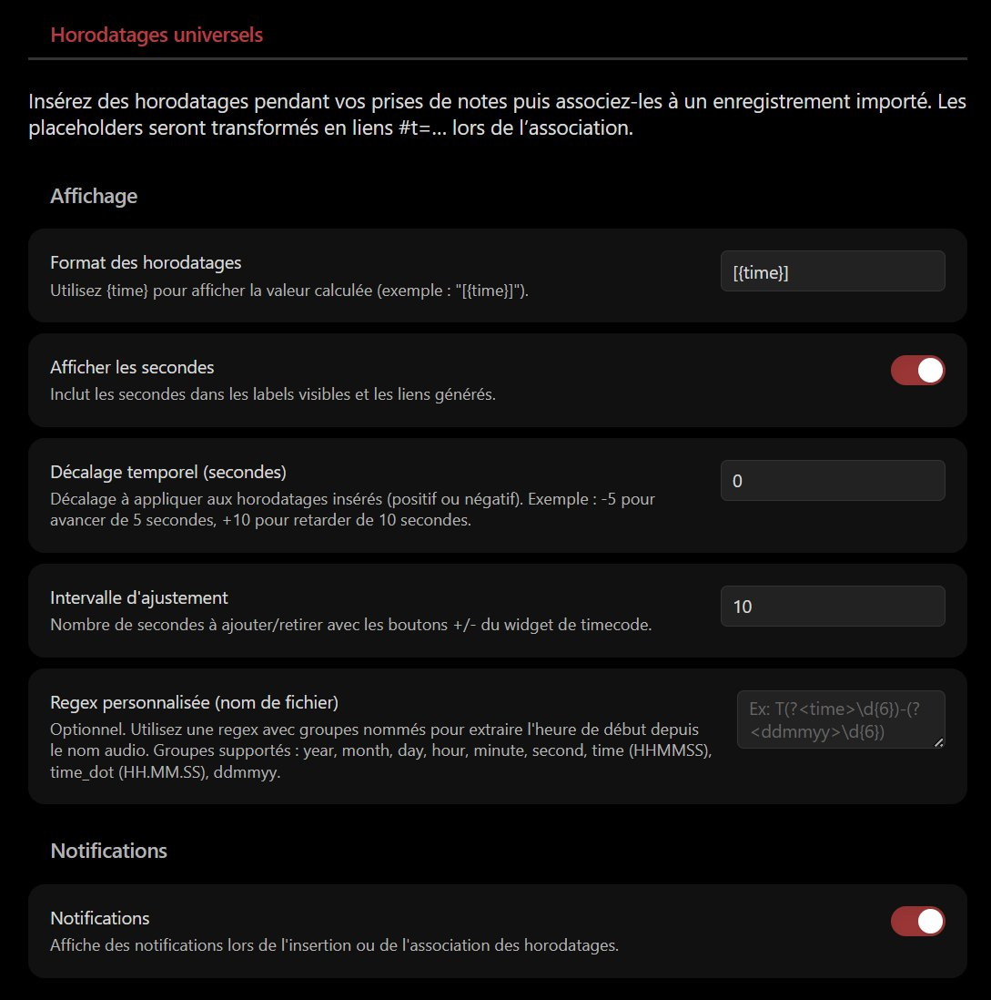
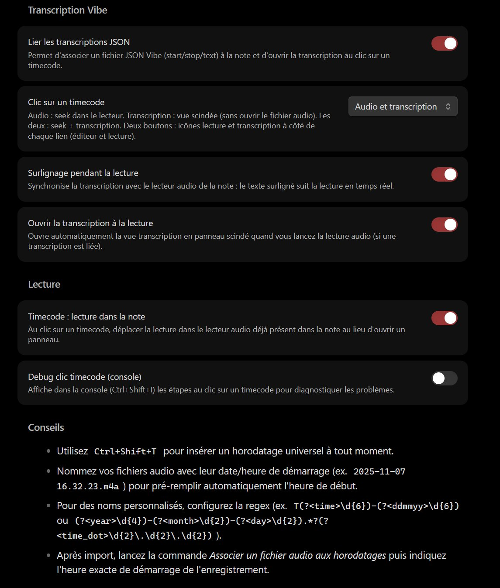

<div align="center">

<table>
<tr>
<td></td>
<td align="left">
<h1 style="margin:0">Universal Timestamp</h1>
<p style="margin:0.25em 0 0"><strong>Marcas temporales universales · notas durante la grabación · enlaces #t=</strong><br/>plugin Obsidian · audio / vídeo · reloj del sistema</p>
</td>
</tr>
</table>

<a href="https://atelier.atechnologie.fr/" title="l'Atelier – asociación de fabricación de libros y herramientas de investigación"></a>  
<sub>Desarrollado por <a href="https://atelier.atechnologie.fr/">l'Atelier</a> — fabricación de libros y herramientas de investigación (EHESS)</sub>

<p>
🇫🇷 <a href="README.md">Français</a> ·
🇬🇧 <a href="README.en.md">English</a> ·
🇩🇪 <a href="README.de.md">Deutsch</a> ·
🇪🇸 <a href="README.es.md"><b>Español</b></a>
</p>

<p>
<a href="https://atelier.atechnologie.fr/"></a>
<a href="https://github.com/Atelier-Recherche/Universal-Timestamp"></a>
<a href="https://obsidian.md/plugins?search=BRAT#"></a>
</p>

</div>

---

## 📸 Vista previa

 

---

## 📖 Acerca de

Un plugin de Obsidian para tomar notas durante una sesión grabada (audio o vídeo) generando **marcas temporales universales** basadas en el reloj del sistema. Una vez importada la grabación, las marcas se convierten en enlaces `#t=` clicables.

> **Nota**: el plugin no graba audio. Se centra en la toma de notas y la sincronización temporal con una grabación externa. En Android, [android-audio-recorder](https://gitlab.com/axet/android-audio-recorder) sirve bien para grabar.

## 🌟 Funciones

- **📝 Marcas temporales universales**: `Ctrl+Shift+T` inserta un marcador con hora (`%%REC{...}%%`) y una etiqueta legible.
- **🔗 Conversión controlada**: el comando « Associer un fichier audio aux horodatages » / « Associate an audio file with timestamps » transforma los marcadores en enlaces `[[archivo#t=123|[02:03]]]`.
- **🔔 Propuesta contextual**: al insertar un enlace a un archivo de audio, el plugin puede ofrecer lanzar la conversión de inmediato (nunca forzada).
- **📂 Reconocimiento de archivos**: detección automática de archivos de audio en el vault (MP3, WAV, M4A, OGG, WebM, MP4, AAC, FLAC).
- **⚙️ Ajustes sencillos**: formato de etiqueta `{time}`, mostrar u ocultar segundos, notificaciones.

## ⬇️ Instalación vía BRAT (1 clic)

> **ID del plugin (catálogo Obsidian)**: `universal-timestamp` — la carpeta en `.obsidian/plugins/` debe llamarse **`universal-timestamp`**.

1. 🔌 Instalar **BRAT**: [Obsidian — BRAT](https://obsidian.md/plugins?search=BRAT#)
2. ➕ Añadir este repositorio con *« Add Beta plugin »*:  
   `https://github.com/Atelier-Recherche/Universal-Timestamp`

> 💡 Nuestros plugins pueden estar pendientes de validación en el catálogo de Obsidian; BRAT permite probarlos ya. Ver también 🌐 [l’Atelier](https://atelier.atechnologie.fr/).

### Instalación manual

1. Descargue `main.js`, `manifest.json` y `styles.css`
2. Cree la carpeta `universal-timestamp` en `.obsidian/plugins/`
3. Coloque los archivos descargados en esa carpeta
4. Reinicie Obsidian
5. Active el plugin en los ajustes

## 🚀 Uso

### 1. Durante la toma de notas

- En cada marca temporal deseada, use el comando **« Insérer un horodatage universel »** / **« Insert a universal timestamp »** (`Ctrl+Shift+T` por defecto).
- Se inserta un marcador del tipo `%%REC{"time":"2025-11-08T16:32:23.123Z"}%%[16:32:23]` en la posición del cursor.

### 2. Tras la grabación

- Copie o importe el archivo de audio/vídeo en su vault de Obsidian.
- Si el nombre del archivo incluye la fecha/hora de inicio (`2025-11-07 16.32.23.m4a`, por ejemplo), el plugin rellenará automáticamente la hora de inicio.

### 3. Conversión de marcas temporales

- Abra la nota con los marcadores.
- Ejecute **« Associer un fichier audio aux horodatages »**.
  - Elija el archivo de audio a vincular.
  - Ajuste la hora de inicio si hace falta (`YYYY-MM-DD HH:mm:ss`).
- Todos los marcadores referenciados se sustituyen por enlaces `#t=` clicables.

### Sugerencias contextuales

Si añade un enlace `[[...]]` a un archivo de audio reconocido, un diálogo ofrece lanzar la conversión de inmediato (puede rechazarla y hacerlo más tarde).

## ⚙️ Ajustes

- **Formato de marcas temporales**: personalice la etiqueta visible (`[{time}]`, `({time})`, etc.).
- **Mostrar segundos**: activa/desactiva los segundos en etiquetas y enlaces.
- **Notificaciones**: muestra avisos al insertar y/o al convertir.

## 📋 Comandos disponibles

- `Insérer un horodatage universel` / `Insert a universal timestamp`
- `Associer un fichier audio aux horodatages` / `Associate an audio file with timestamps`

## 🔧 Desarrollo

### Requisitos previos

- Node.js 16+
- npm o yarn

```bash
npm install
npm run dev
npm run build
```

## 📱 Compatibilidad

| Plataforma | Estado |
|------------|--------|
| Windows Desktop | ✅ Compatible |
| macOS Desktop | ✅ Compatible |
| Linux Desktop | ✅ Compatible |
| Android | ✅ Compatible |
| iOS | ✅ Compatible |

## Conformidad con el catálogo Obsidian

| Elemento | Detalle |
| --- | --- |
| **Licencia** | MIT — [LICENSE](LICENSE) |
| **Red** | no — marcas temporales locales, archivos de audio solo en el vault |
| **Archivos fuera del vault** | no |
| **Telemetría / actualización automática** | no |
| **Release** | `.\Release-Plugin.ps1` |

## 🙏 Agradecimientos

Inspirado en [Media Extended](https://github.com/aidenlx/media-extended), con énfasis en el flujo de marcas durante la grabación y la compatibilidad móvil.

## 🔗 Recursos

| | |
| --- | --- |
| 🌐 **l'Atelier** | [atelier.atechnologie.fr](https://atelier.atechnologie.fr/) |
| 📦 **Repositorio** | [github.com/Atelier-Recherche/Universal-Timestamp](https://github.com/Atelier-Recherche/Universal-Timestamp) |

---

<div align="center">

<sub><a href="README.md">🇫🇷 Français</a> · <a href="README.en.md">🇬🇧 English</a> · <a href="README.de.md">🇩🇪 Deutsch</a> · <b>🇪🇸 Español</b></sub>

</div>
