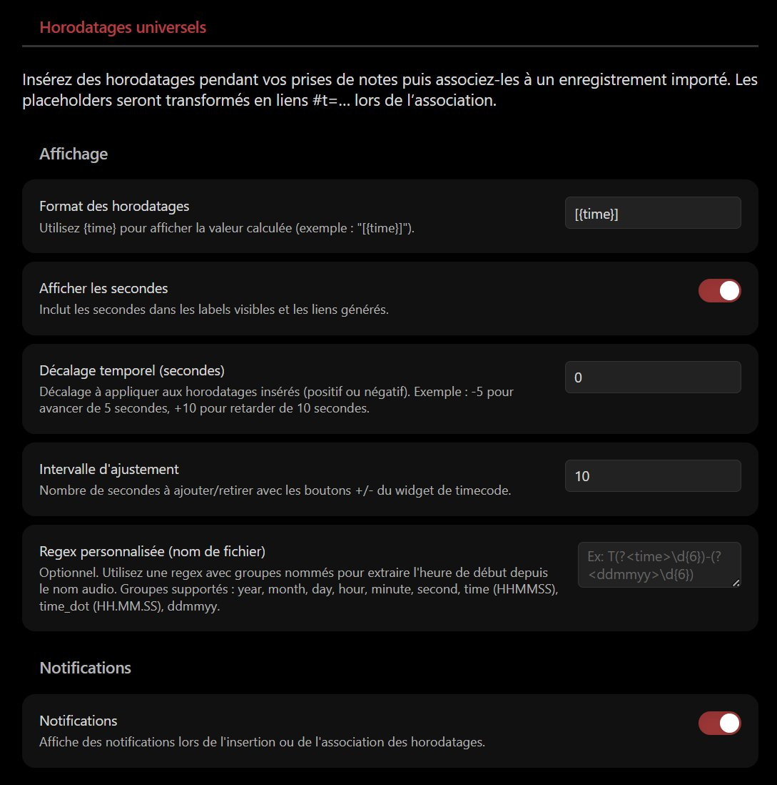
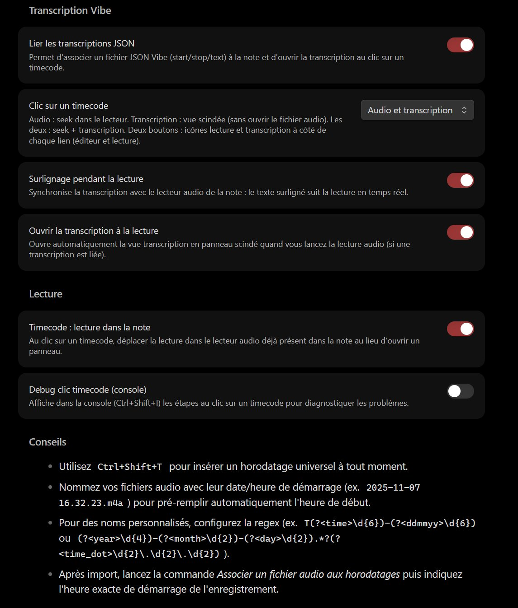

<div align="center" id="head">


<table>
<tr>
<td></td>
<td align="left">
<h1 style="margin:0">Universal Timestamp</h1>
<p style="margin:0.25em 0 0"><strong>Horodatages universels · notes pendant enregistrement · liens #t=</strong><br/>plugin Obsidian · audio / vidéo · horloge système</p>
</td>
</tr>
</table>

<a href="https://atelier.atechnologie.fr/" title="l'Atelier – Association de fabrication de livres et d'outils de recherche"></a>  
<sub>Développé par <a href="https://atelier.atechnologie.fr/">l'Atelier</a> — fabrication de livres et outils de recherche (EHESS)</sub>

<p>
🇫🇷 <a href="README.md"><b>Français</b></a> ·
🇬🇧 <a href="README.en.md">English</a> ·
🇩🇪 <a href="README.de.md">Deutsch</a> ·
🇪🇸 <a href="README.es.md">Español</a>
</p>

<p>
<a href="https://atelier.atechnologie.fr/"></a>
<a href="https://github.com/Atelier-Recherche/Universal-Timestamp"></a>
<a href="https://obsidian.md/plugins?search=BRAT#"></a>
</p>

</div>

---

## 📸 Aperçu

 

---

## 📖 À propos

Plugin Obsidian pour prendre des notes pendant une session enregistrée (audio ou vidéo) en générant des **horodatages universels** basés sur l’horloge système. Une fois l’enregistrement importé, les horodatages sont convertis en liens `#t=` cliquables.

> **Note** : le plugin n’enregistre pas l’audio. Il se concentre sur la prise de notes et la synchronisation temporelle avec un enregistrement externe. Sur Android, [android-audio-recorder](https://gitlab.com/axet/android-audio-recorder) convient bien pour l’enregistrement.

## 🌟 Fonctionnalités

- **📝 Horodatages universels** : `Ctrl+Shift+T` insère un marqueur horodaté (`%%REC{...}%%`) accompagné d’un libellé lisible.
- **🔗 Conversion contrôlée** : commande « Associer un fichier audio aux horodatages » pour transformer les marqueurs en liens `[[fichier#t=123|[02:03]]]`.
- **🔔 Proposition contextuelle** : lorsqu’un lien vers un fichier audio est inséré dans la note, le plugin peut proposer immédiatement de lancer la conversion (aucune action forcée).
- **📂 Reconnaissance des fichiers** : détection automatique des fichiers audio (MP3, WAV, M4A, OGG, WebM, MP4, AAC, FLAC) déjà présents dans le coffre.
- **⚙️ Paramètres épurés** : format du libellé `{time}`, affichage ou non des secondes, notifications.

## ⬇️ Installation via BRAT (1 clic)

> **ID du plugin (catalogue Obsidian)** : `universal-timestamp` — le dossier dans `.obsidian/plugins/` doit s’appeler **`universal-timestamp`**.

1. 🔌 Installer **BRAT** : [Obsidian — BRAT](https://obsidian.md/plugins?search=BRAT#)
2. ➕ Ajouter ce dépôt avec l’option *« Add Beta plugin »* :  
   `https://github.com/Atelier-Recherche/Universal-Timestamp`

> 💡 Nos plugins peuvent être en attente de validation sur le catalogue Obsidian ; BRAT permet de les tester dès maintenant. Voir aussi 🌐 [l’Atelier](https://atelier.atechnologie.fr/).

### Installation manuelle

1. Téléchargez les fichiers `main.js`, `manifest.json` et `styles.css`
2. Créez un dossier `universal-timestamp` dans `.obsidian/plugins/`
3. Placez les fichiers téléchargés dans ce dossier
4. Redémarrez Obsidian
5. Activez le plugin dans les paramètres

## 🚀 Utilisation

### 1. Pendant la prise de notes

- À chaque repère temporel souhaité, utilisez la commande **« Insérer un horodatage universel »** (`Ctrl+Shift+T` par défaut).
- Un placeholder du type `%%REC{"time":"2025-11-08T16:32:23.123Z"}%%[16:32:23]` est inséré à l’emplacement du curseur.

### 2. Après l’enregistrement

- Copiez ou importez le fichier audio/vidéo dans votre coffre Obsidian.
- Si le fichier possède un nom incluant la date/heure de démarrage (`2025-11-07 16.32.23.m4a`, par exemple), le plugin pré-remplira automatiquement l’heure de début.

### 3. Conversion des horodatages

- Ouvrez la note contenant vos placeholders.
- Lancez la commande **« Associer un fichier audio aux horodatages »**.
  - Choisissez le fichier audio à lier.
  - Ajustez l’heure de démarrage si nécessaire (format `YYYY-MM-DD HH:mm:ss`).
- Tous les placeholders référencés sont remplacés par des liens `#t=` cliquables.

### Suggestions contextuelles

Si vous ajoutez un lien `[[...]]` vers un fichier audio reconnu, une fenêtre vous propose de lancer immédiatement la conversion (vous pouvez refuser et le faire plus tard).

## ⚙️ Paramètres

- **Format des horodatages** : personnalisez l’affichage visible (`[{time}]`, `({time})`, etc.).
- **Afficher les secondes** : active/désactive les secondes dans les libellés et les liens.
- **Notifications** : affiche des notifications lors de l’insertion et/ou de la conversion.

## 📋 Commandes disponibles

- `Insérer un horodatage universel`
- `Associer un fichier audio aux horodatages`

## 🔧 Développement

### Prérequis

- Node.js 16+
- npm ou yarn

```bash
npm install
npm run dev
npm run build
```

## 📱 Compatibilité

| Plateforme | Statut |
|------------|--------|
| Windows Desktop | ✅ Supporté |
| macOS Desktop | ✅ Supporté |
| Linux Desktop | ✅ Supporté |
| Android | ✅ Supporté |
| iOS | ✅ Supporté |

## Conformité catalogue Obsidian

| Élément | Détail |
| --- | --- |
| **Licence** | MIT — [LICENSE](LICENSE) |
| **Réseau** | non — horodatages locaux, fichiers audio dans le coffre uniquement |
| **Fichiers hors vault** | non |
| **Télémétrie / mise à jour auto** | non |
| **Release** | `.\Release-Plugin.ps1` |

## 🙏 Remerciements

Inspiré par le plugin [Media Extended](https://github.com/aidenlx/media-extended), avec un focus sur l’indicateur d’enregistrement et la compatibilité mobile.

## 🔗 Ressources

| | |
| --- | --- |
| 🌐 **l'Atelier** | [atelier.atechnologie.fr](https://atelier.atechnologie.fr/) |
| 📦 **Dépôt** | [github.com/Atelier-Recherche/Universal-Timestamp](https://github.com/Atelier-Recherche/Universal-Timestamp) |

---

<div align="center">

<sub><b>🇫🇷 Français</b> · <a href="README.en.md">🇬🇧 English</a> · <a href="README.de.md">🇩🇪 Deutsch</a> · <a href="README.es.md">🇪🇸 Español</a></sub>

</div>
